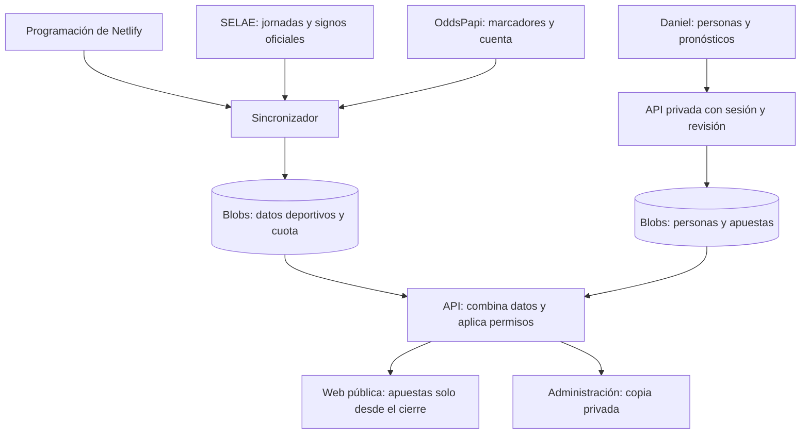

# Flujo de la aplicación

La tarea habitual de Daniel es **seleccionar una jornada importada, rellenar o corregir los pronósticos de cada participante y guardar**. Las jornadas, los cruces, sus horarios y los resultados se obtienen desde las fuentes deportivas. Los demás participantes consultan la web sin registrarse.

Esta guía describe el funcionamiento implementado. Para que opere automáticamente en producción falta configurar y verificar el despliegue en Netlify; no se ha publicado durante este encargo. La integración autenticada de OddsPapi todavía no está comprobada con la suscripción real.

## 1. Preparación inicial

Se hace al poner la aplicación en servicio, no cada jornada:

1. Configurar el acceso de Daniel con `ADMIN_PASSWORD_HASH` y `ADMIN_SESSION_SECRET`, exclusivamente en Functions.
2. Guardar la clave exclusiva de Materos como `ODDSPAPI_KEY`, también en Functions y solo en producción. Su valor no se introduce en Angular ni en el panel de Administración.
3. Desplegar y comprobar que Netlify registra la función programada, conserva los datos en Blobs y protege el acceso privado y los pronósticos anteriores al cierre.
4. Verificar la cuenta, cuota y cobertura real de OddsPapi mediante una comprobación controlada. Las pruebas automáticas usan simulaciones y no consumen cuota.

Los nueve participantes existentes se conservan. El seed solo inicializa un almacenamiento vacío; no sustituye personas ni apuestas ya guardadas. Los datos de desarrollo local no se trasladan automáticamente a producción.

Instrucciones concretas: [acceso y persistencia](administracion.md) y [configuración de las fuentes](sincronizacion.md).

## 2. La aplicación prepara las jornadas

En producción, Netlify ejecuta el sincronizador cada **15 minutos**, aunque nadie tenga abierta la web. Cada ejecución realiza únicamente el trabajo pendiente que cabe en sus límites de tiempo y presupuesto; no consulta todos los partidos en cada ciclo.

El descubrimiento de jornadas SELAE se actualiza cada seis horas e incluye jornadas entre semana. La aplicación valida la identidad oficial y los 15 encuentros, conserva el orden del boleto y guarda los horarios con su zona horaria. Las siguientes sincronizaciones actualizan esos horarios sin duplicar jornadas ni borrar apuestas. También se recuperan jornadas recientes y se revisan resultados ya confirmados para detectar correcciones.

En **Administración → Jornadas** aparecen los boletos importados y el estado de sincronización. Si todavía no hay ninguno, se muestra el estado vacío: no se generan encuentros de ejemplo ni se solicita completar los equipos a mano.

La opción **Jornada actual** sigue esta regla:

1. La más antigua que haya empezado y aún no tenga los 14 signos y el Pleno confirmados.
2. Si no existe una así, la próxima jornada.
3. Si tampoco hay una próxima, la última disponible.

Publicar un nuevo boleto no desplaza uno que sigue en juego. Un aplazamiento sin liquidar puede mantener la jornada actual; las demás continúan disponibles en el selector y el histórico.

## 3. Daniel introduce los pronósticos

1. Entrar en `/acceso` con `daniel-arroyo`. Con la sesión validada aparece **Administración**.
2. Abrir **Quinielas** y seleccionar una jornada ya importada y un participante.
3. Marcar los 14 pronósticos o pegarlos. Se admiten `1`, `X`, `2`, `1X`, `12` y `X2`: entre cero y dos dobles por persona, sin triples. El contador muestra los dobles usados; tanto el formulario como el servidor rechazan un tercero.
4. Rellenar el Pleno por separado, con `0`, `1`, `2` o `M` para cada equipo. `M` significa tres o más goles.
5. Guardar y repetir con los demás participantes. El listado indica quién tiene su quiniela completa y quién falta. Solo se guarda una quiniela completa, con los 14 signos y el Pleno.

Para corregir una apuesta, volver a seleccionar la misma jornada y persona, cambiar sus valores y pulsar **Actualizar quiniela**. La corrección sustituye esa apuesta, sin duplicarla. También se permiten correcciones después del cierre, que entonces afectan a la vista pública.

Los campos sin guardar permanecen durante el refresco automático del panel. Si otra sesión administrativa ha guardado cambios, se avisa del conflicto: conviene conservar los cambios pendientes antes de recargar y volver a aplicarlos sobre la versión actual. No se sobrescribe silenciosamente una edición concurrente.

**Personas** permite altas, bajas y reincorporaciones cuando sean necesarias. Dar de baja conserva las apuestas y el histórico; Daniel no puede desactivarse desde el panel. Los participantes no necesitan una cuenta para consultar.

Formato de pegado y reglas detalladas: [jornadas y quinielas](datos.md).

## 4. Antes y después del cierre

Antes del cierre, Daniel puede consultar las apuestas desde el panel privado. La API pública no entrega los pronósticos ni el Pleno: la protección se aplica en el servidor, no consiste solo en ocultar celdas en pantalla.

El cierre toma la hora de venta publicada por SELAE, sin superar el primer inicio conocido. Si falta esa hora, solo se usa el primer inicio como alternativa cuando se conocen los 15 horarios. Sin un cierre fiable, los pronósticos continúan privados. Los cambios de horario pueden ajustar un cierre futuro; una jornada que ya se ha publicado no vuelve a ocultarse.

Al alcanzar el cierre según el reloj del servidor, la siguiente lectura pública incluye las apuestas. En **Jornadas** se puede consultar la comparativa, cambiar de participante, usar filtros y revisar el Pleno. En escritorio se mantiene una columna por participante; en móvil se puede usar la vista individual o la comparación horizontal.

## 5. Durante los partidos y al confirmarse los resultados

OddsPapi proporciona marcadores deportivos disponibles. Como pauta inicial se programan consultas alrededor de inicio +60 y +120 minutos, recalculadas con los horarios actualizados. Esos momentos no demuestran que un partido esté en descanso o haya terminado. La cola y el presupuesto pueden retrasar u omitir consultas intermedias; la aplicación no ofrece un directo riguroso.

| Estado              | Qué significa para quien consulta                                                                       | Efecto en la clasificación                |
| ------------------- | ------------------------------------------------------------------------------------------------------- | ----------------------------------------- |
| Pendiente           | Falta un resultado oficial y no hay marcador provisional evaluable.                                     | No suma aciertos ni fallos.               |
| Provisional         | El marcador disponible permite mostrar un posible acierto o fallo, con su actualización. Puede cambiar. | No cuenta para el histórico.              |
| Confirmado          | SELAE ha publicado el signo oficial o el Pleno correspondiente. Tiene prioridad sobre el marcador.      | Cuenta como acierto o fallo oficial.      |
| Dato desactualizado | Una actualización ha fallado y se conserva el último dato disponible.                                   | No convierte un marcador en confirmación. |

Cada partido acertado suma **un acierto**, incluido un doble que contenga el signo oficial. El máximo de los primeros 14 sigue siendo 14; el Pleno se evalúa por separado. No hay premios económicos ni puntos adicionales.

La **Clasificación** acumula los resultados oficiales de la temporada. Las victorias de una jornada se adjudican al confirmar sus 14 signos y se comparten si hay empate en aciertos; no requieren que el Pleno esté confirmado. En cambio, la selección automática de jornada actual espera también al Pleno. Una corrección oficial posterior recalcula los valores afectados.

Los aplazamientos, suspensiones o signos administrativos no generan goles inventados. Un marcador ausente no se interpreta como 0–0; prórroga y tanda no se suman al marcador de los 90 minutos.

## 6. Cómo llegan los cambios a todos

Todas las visitas leen la misma copia guardada. Abrir la página, cambiar de participante o comparar columnas **no llama a OddsPapi**. La web refresca sus datos cada cinco minutos mientras está visible y cuando se vuelve a la pestaña, conservando selección, filtros y posición. Por eso una actualización de la fuente puede tardar en aparecer en una pantalla ya abierta.

Los datos deportivos y las apuestas tienen almacenamiento y revisiones separados: el sincronizador no escribe las apuestas privadas. Producción conserva los datos entre despliegues; las previews están aisladas y no consumen OddsPapi. El horario automático se ejecuta en producción; el desarrollo local permite probar SELAE con el reintento del panel, pero no consulta OddsPapi.

## 7. Qué hacer ante una incidencia

| Situación                                                                | Comportamiento y acción                                                                                                                                |
| ------------------------------------------------------------------------ | ------------------------------------------------------------------------------------------------------------------------------------------------------ |
| SELAE falla o publica un boleto inválido                                 | Se conserva lo guardado y se muestra el estado. Consultar Administración → Jornadas; el reintento es una ayuda puntual, no una tarea semanal.          |
| Falta la clave de OddsPapi o no hay correspondencia segura de un partido | Puede faltar el marcador provisional. La importación y la confirmación de SELAE siguen siendo independientes. Revisar la configuración o la cobertura. |
| Se agota el presupuesto operativo                                        | Se detienen las llamadas facturables; el reintento no permite saltarse el límite. Se conserva la información y continúa SELAE.                         |
| Falla una consulta de marcador                                           | Se conserva el último dato y se señala desactualizado. No se encadenan reintentos automáticos del mismo intento.                                       |
| Hay una revisión privada distinta                                        | El guardado se rechaza con conflicto. Revisar los cambios de la otra sesión antes de volver a guardar.                                                 |
| Caduca la sesión administrativa                                          | Volver a acceder; la consulta pública permanece disponible.                                                                                            |

El presupuesto contrasta la cuenta real con las reservas persistidas. El objetivo es un máximo operativo de 200 llamadas y una reserva de 50, respetando siempre un límite real inferior. Descubrimiento, metadatos y errores también consumen ese margen. El botón de reintento no habilita gasto de emergencia.

La configuración exacta, los límites conocidos del proveedor y las verificaciones remotas pendientes están en [sincronización](sincronizacion.md). La evidencia de las pruebas locales está en [verificación](verificacion.md).
